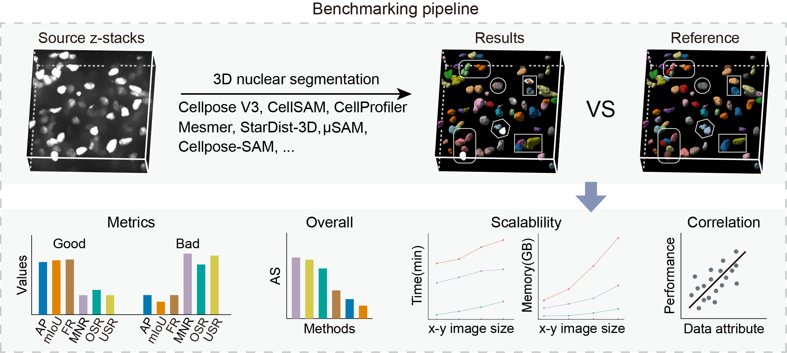

# Benchmark

[← Repository overview](../README.md)

The **Benchmark** module provides scripts and notebooks for evaluating 3D nuclear segmentation methods and analyzing their performance. The associated study benchmarks **fourteen algorithms** on the NuPatch3D dataset, with analyses of segmentation accuracy, computational scalability, and relationships between performance and data characteristics.

## Benchmarking workflow



**Figure 1.** Benchmarking of 3D nuclear segmentation algorithms against reference annotations, covering segmentation accuracy, overall rankings, computational scalability, and correlations with data attributes.

## Components

| Component | Purpose | Resources |
| --- | --- | --- |
| Segmentation methods | Run segmentation methods with default parameters. | [Scripts and setup notes](segmentation_scripts) |
| Evaluation metrics | Compare predictions with ground-truth instance labels using rule-based instance matching and foreground coverage. | [Metric definitions and usage](metrics/README.md) |
| Image and nucleus descriptors | Extract shape, density, and intensity descriptors. | [Descriptor extraction guide](descriptors/README.md) |
| Analysis and visualization | Analyze metric summaries, method rankings, and associations between metrics and descriptors. | [Analysis notebooks](plot) |

Segmentation scripts require method-specific environments; Some methods also require model weights or parameter files that are not supplied here; see the corresponding method's project documentation.

## Evaluate predictions

### Data access

The NuPatch3D data are hosted on **OMIX** as **NuPatch3D dataset human**, **NuPatch3D dataset mouse**, and **NuPatch3D dataset label**. The human and mouse collections are publicly accessible. To obtain reference labels for evaluation, submit a data access request through the OMIX website for the **NuPatch3D dataset label** collection. We will approve requests whenever permitted by applicable policies.
And an additional **NuPatch3D dataset public** collection is available via the [USTC Cloud sharing link](https://pan.ustc.edu.cn/share/index/04b80fa42492484c9f62).

See [Dataset availability](../NuPatch3D-dataset/README.md#availability) for OMIX accessions, download links, and access instructions.

### Inputs and usage

The evaluator accepts spatially aligned **3D instance-label TIFFs in ZYX order**, with background `0` and positive integer instance IDs. Configure the physical voxel spacing (`SPACING`, in μm) in the [evaluation script](metrics/evaluate_3d_segmentation_parallel.py) for your images.

From the repository root:

```bash
pip install numpy pandas tifffile

python Benchmark/metrics/evaluate_3d_segmentation_parallel.py \
  --gt-dir /path/to/ground_truth \
  --pred-root /path/to/predictions \
  --output results/metrics.csv \
  --workers 4
```

Outputs contain six metrics: `FR`, `IoU`, `OSR`, `USR`, `MNR`, and `AP`. `AP` uses rule-based matching and equals TP / (TP + FP + FN); it is not a precision–recall curve integral. File identifiers, matching counts, physical volumes, and cropping warnings are retained as auxiliary information. See the [metrics guide](metrics/README.md) for definitions and usage.

## Related modules

[NuPatch3D Tool](../NuPatch3D-tool/README.md) · [NuPatch3D Dataset](../NuPatch3D-dataset/README.md)
