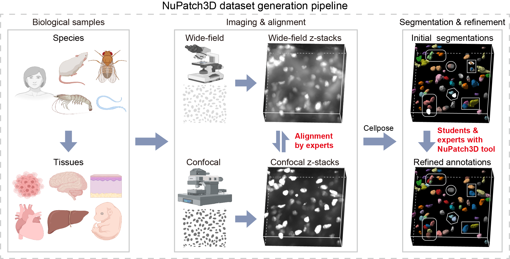
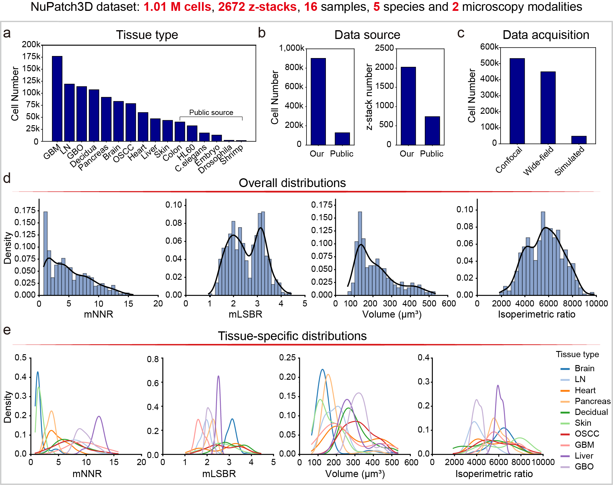

# NuPatch3D Dataset

[← Repository overview](../README.md)

**NuPatch3D Dataset** is a resource for 3D nuclear instance segmentation, containing approximately **1.01 million annotated nuclei** across **2,672 z-stacks**, **16 samples**, and **5 species**. It includes two microscopy modalities—**confocal** and **wide-field**—as well as simulated data. Data are hosted on OMIX, with public access to the human and mouse parts and access to labels upon request through the OMIX website.

## Availability

The data are deposited in **OMIX** in three parts:

| Data collection | Access | OMIX accession | Download link |
| --- | --- | --- | --- |
| **NuPatch3D dataset human** | Publicly accessible | | |
| **NuPatch3D dataset mouse** | Publicly accessible | | |
| **NuPatch3D dataset label** | Request access through the OMIX website, subject to applicable policies | | |

To access the **NuPatch3D dataset label** collection, submit a data access request through the OMIX website for the corresponding collection. We welcome requests and will approve them whenever permitted by applicable policies.

## Dataset construction

**Figure 1.** Construction of the NuPatch3D dataset through biological sample collection, imaging and alignment, and refinement of initial Cellpose segmentations using NuPatch3D.

## Dataset characteristics

**Figure 2.** Composition of the NuPatch3D dataset by sample type, data source, and acquisition method, with distributions of nuclear density, image quality and nuclear morphology.

The input requirements of the current evaluation code are documented separately in the [benchmark metrics guide](../Benchmark/metrics/README.md).

## Related modules

[NuPatch3D Tool](../NuPatch3D%20tool/README.md) · [Benchmark](../Benchmark/README.md)
