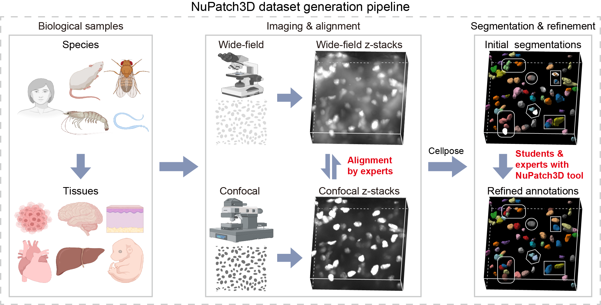
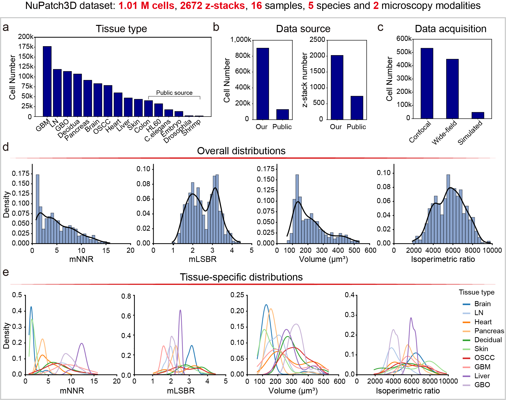
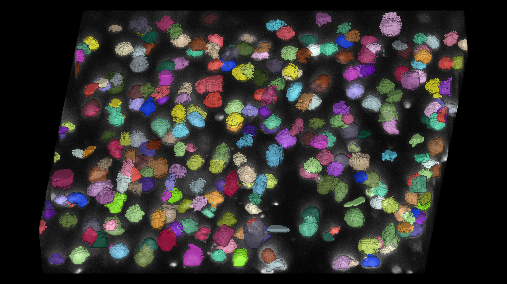
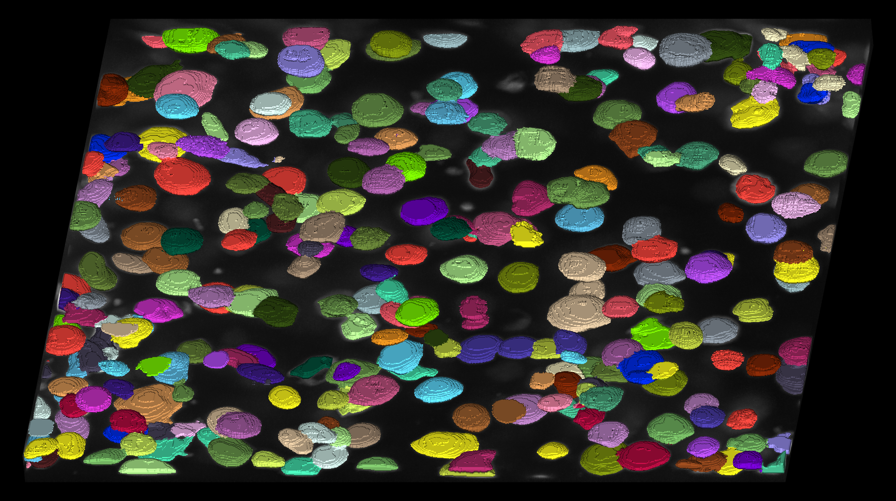

# NuPatch3D Dataset

[← Repository overview](../README.md)

**NuPatch3D Dataset** is a resource for 3D nuclear segmentation, containing approximately **1.01 million annotated nuclei** across **2,672 z-stacks**, **16 samples**, and **5 species**. It includes two microscopy modalities—**confocal** and **wide-field**—as well as simulated data. The newly acquired human, mouse, and label collections are hosted on OMIX, with public access planned for the human and mouse parts and access to labels upon request through the OMIX website after publication. The public collection is hosted on USTC Cloud.

## Availability

The human, mouse, and label collections are deposited in **OMIX**, while the public collection is shared by a USTC Cloud link (All datasets will be released after publication of the article):

| Data collection | Access after publication | Accession | Download link |
| --- | --- | --- | --- |
| **NuPatch3D dataset human** | Publicly accessible |OMIX023136 |[Download here](https://ngdc.cncb.ac.cn/omix/release/OMIX023136) (unreleased now)|
| **NuPatch3D dataset mouse** | Publicly accessible |OMIX023144 |[Download here](https://ngdc.cncb.ac.cn/omix/release/OMIX023144) (unreleased now)|
| **NuPatch3D dataset label** | Request access through the OMIX website, subject to applicable policies |OMIX023146 | [Download here](https://ngdc.cncb.ac.cn/omix/release/OMIX023146)|
| **NuPatch3D dataset public** | Publicly accessible |- |[Download here]()(unreleased now) |

To access the **NuPatch3D dataset label** collection, submit a data access request through the OMIX website for the corresponding collection. We welcome requests and will approve them whenever permitted by applicable policies.

## Dataset construction

**Figure 1.** Construction of the NuPatch3D dataset through biological sample collection, imaging and alignment, and refinement of initial Cellpose segmentations using NuPatch3D.

## Dataset characteristics

**Figure 2.** Composition of the NuPatch3D dataset by sample type, data source, and acquisition method, with distributions of nuclear density, image quality and nuclear morphology.

## Example data

Two example image stacks and their corresponding nuclear segmentation labels are included in the [`examples/`](./examples/) folder for exploring the data and trying the NuPatch3D tool. Each image and its label volume have matching dimensions.

| Example | Image stack | Volume shape (Z × Y × X) | Res(Z, Y, X; $\mu m$)|
| --- | --- | --- | --- |
| Brain | [example1_brain.tif](./examples/example1_brain.tif) | 71 × 512 × 512 | (1, 0.4151, 0.4151)
| Pancreas | [example2_pancreas.tif](./examples/example2_pancreas.tif) | 45 × 1049 × 1049 |(1, 0.1377, 0.1377)

**Figure 3.** Snapshot of the brain example, showing colored nuclear segmentation labels overlaid on the grayscale image.

**Figure 4.** Snapshot of the pancreas example, showing colored nuclear segmentation labels overlaid on the grayscale image.

## Related modules

[NuPatch3D Tool](../NuPatch3D-tool/README.md) · [Benchmark](../Benchmark/README.md)
