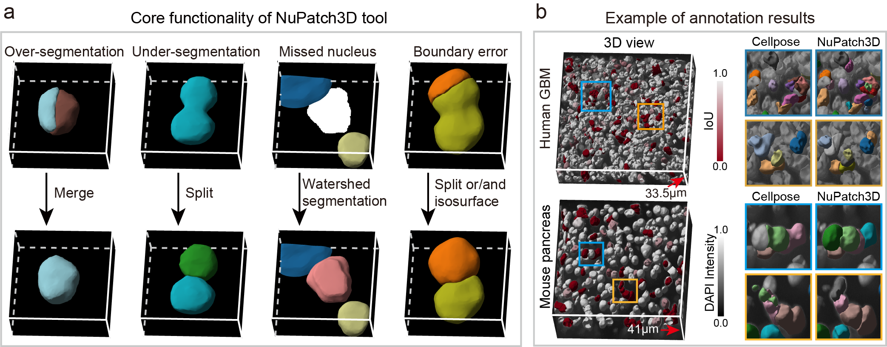

# NuPatch3D Tool

[← Repository overview](../README.md)

**NuPatch3D Tool** is a [napari](https://napari.org/) plugin for post-processing 3D nuclear segmentation results. It provides interactive tools to correct under-segmentation, over-segmentation, missing nuclei, and boundary inaccuracies.

Label merging also supports removal of false-positive nuclear instances by assigning their labels to the background.



**Figure 1.** Core correction functions of NuPatch3D and representative human GBM and mouse pancreas annotations, comparing initial Cellpose segmentations with refined results.

## Features

- **Local editing** — Extract and refine individual cells or neighborhoods in an isolated bounding box; changes are written back to the global segmentation only after you Commit
- **Under-segmentation split** — Separate merged cells using plane-based, GMM auto, manual center modes
- **Over-segmentation merge** — Merge fragmented labels or delete spurious ones
- **Boundary refinement** — Adjust cell boundaries based on local image intensity
- **Missing cell detection** — Add omitted cells via interactive seed points and watershed
- **Full undo/redo & JSON logging** — Up to 10-step undo/redo with traceable, reproducible editing workflow; supports recovery from JSON logs
- **Seamless napari integration** — Works with native napari brush, eraser, and fill tools; all operations are recorded in the unified edit history

## Requirements

- **OS:** Windows 10 or macOS 26 (Tahoe) and above, as listed in the existing user manual.
- **RAM:** 16 GB or more.
- **Python:** >=3.10; Python 3.11 is recommended for the installation environment.
- **NumPy:** >=2.0,<3; the plugin uses `np.asarray(..., copy=True)`, introduced in NumPy 2.0.
- **napari:** >=0.6,<0.7; other versions may have compatibility issues.

These requirements apply to the NuPatch3D plugin. Benchmark segmentation methods require separate, method-specific environments. The version bounds reflect API requirements, not a fully tested environment lockfile.

## Installation

Install napari and the plugin in your Python environment:

```bash
conda create -n NuPatch3D python=3.11
conda activate NuPatch3D
pip install NuPatch3D
```

For local development:

```bash
git clone https://github.com/QuKunLab/NuPatch3D.git
cd "NuPatch3D/NuPatch3D-tool"
pip install -e .
```

Launch napari with `napari`, then open **Plugins → NuPatch3D (NuPatch-3D)**. Load your microscopy image and instance-label segmentation, and select the corresponding layers in the plugin panel.

## Documentation

- [English user manual](https://github.com/QuKunLab/NuPatch3D/docs/en/)
- [中文用户手册](https://github.com/QuKunLab/NuPatch3D/docs/)
- [Installation and setup](../docs/en/environment.md)
- [Loading images and segmentation labels](../docs/en/loading.md)
- [Saving results](../docs/en/save.md) and [recovering edits](../docs/en/restore.md)

## Related modules

[NuPatch3D Dataset](../NuPatch3D-dataset/README.md) · [Benchmark](../Benchmark/README.md)
